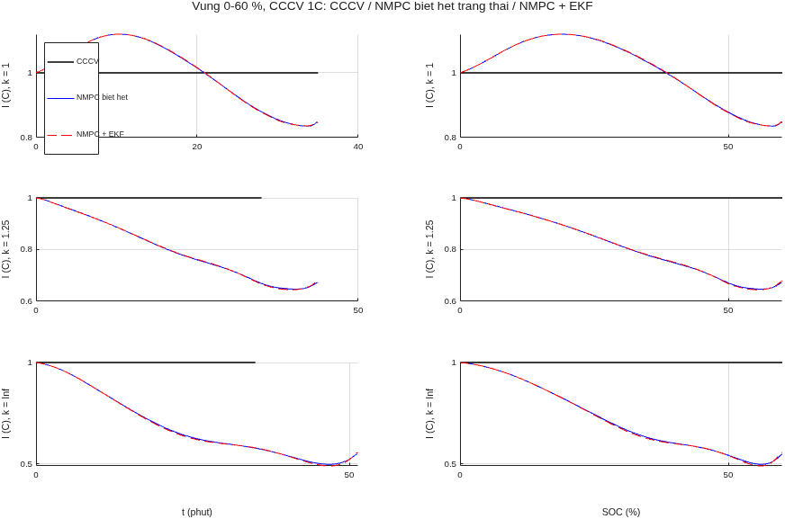
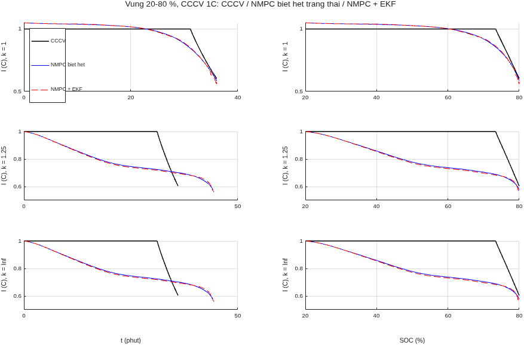
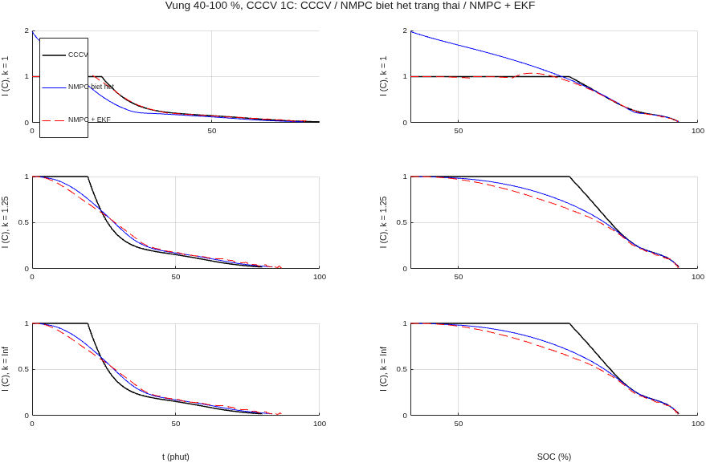
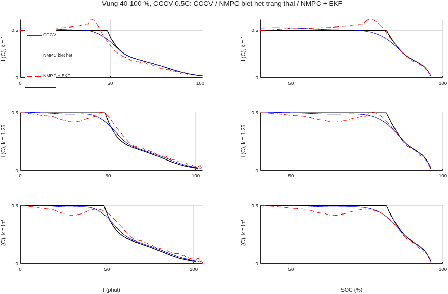

# Kết quả NMPC + EKF (bộ điều khiển thực tế) so với CCCV và NMPC biết hết trạng thái, 25 °C

Cập nhật 19/11/2026. Cùng lưới với chạy thử NMPC biết hết trạng thái (`ket_qua_pilot_nmpc.md`): 3 vùng (0→60, 20→80, 40→100 %) × CCCV 0.5C / 1C × 7 mức ngân sách k = 42 trường hợp. Run **44332295621** (`nmpc.yml` stage pilot, biến thể `pilot+ekf`, code f4cee08). Số liệu đầy đủ: `tai_lieu/ket_qua_nmpc_ekf.csv` (gộp bằng `src/nmpc/ekf_pilot_table.py` từ CSV của các job; cột `*_full*` lấy từ `ket_qua_pilot_nmpc.csv`).

## 1. Cách chạy (GD-89)

- Bộ điều khiển **chỉ thấy tín hiệu đo** của pin thật (DFN): điện áp, dòng, nhiệt độ bề mặt, mỗi 5 s, có nhiễu cảm biến mức BMS (GD-71: σ_V 2 mV, σ_I 25 mA, σ_T 0.5 K). Trạng thái bên trong do EKF ước lượng (cấu hình đã chọn: IEKF 5 lần lặp, tìm theo đường + fading, giữ R_film/LLI cố định trong lần sạc; GD-75, GD-78).
- NMPC giữ nguyên: cùng ROM, cùng hàm mục tiêu, **biên an toàn δ = 45 mV không đổi** (người dùng chốt 18/11/2026). DFN với tham số danh định vẫn là pin thật và chấm điểm.
- EKF bắt đầu với SOC đoán sai **+10 %** (như `ekf_run_case`, GD-77), rồi đọc 60 s áp nghỉ trước khi sạc. Sau 60 s nghỉ, sai SOC còn −0.02 … −0.59 % (cột "sai SOC đầu").
- **Tắt** phần bù lệch η pin − ROM (GD-88 a): nó cần η của DFN, tức cần biết hết trạng thái. Cũng tắt kiểm tra ngân sách trên DFN (GD-88 b). Bù lệch điện áp v_b (GD-83) dùng V **đo** (có nhiễu).
- Đích nạp viết theo điện tích (như CCCV): NMPC + EKF phải nạp đúng lượng điện tích mà CCCV nạp; dừng khi đủ điện tích hoặc khi V đo chạm ngưỡng và dòng ≤ C/50.
- Lão hoá vẫn là chấm hậu kiểm **tạm thời** (GD-81, `posthoc_provisional`), giống bảng biết hết trạng thái. Mất CCCV trùng đúng số của `ket_qua_pilot_nmpc.csv` ở cả 6 trường hợp (kiểm tra hồi quy).

## 2. Bảng kết quả

"giảm" = 1 − mất NMPC / mất CCCV (dương = tốt hơn CCCV). "NMPC+EKF so biết hết TT" = mất NMPC+EKF / mất NMPC biết hết − 1 (dương = EKF làm mất nhiều hơn). Trạng thái: ok; ok_violation = vi phạm trên DFN (ngưỡng 1 mV cho V/η); failed = **nạp thiếu** (SOC cuối thấp hơn đích > 0.2 %); infeasible = không thể sạc an toàn trong thời gian này. Trong ngoặc là trạng thái của NMPC biết hết trạng thái. Sai số ước lượng tính trong lúc sạc (mọi bước EKF 5 s), so với DFN.

| Vùng | CCCV | k | trạng thái (biết hết TT) | t sạc (s) | mất CCCV (mAh) | mất NMPC+EKF (mAh) | giảm so CCCV (%) | giảm biết hết TT (%) | NMPC+EKF so biết hết TT (%) | η_Li min DFN (mV) | vi phạm V / η (mV) | T max (°C) | sai SOC đầu (%) | SOC RMSE / max (%) | η RMSE (mV) | η ước cao max (mV) | lần giải / thất bại | giải TB (ms) | EKF (ms/bước) |
|---|---|---|---|---|---|---|---|---|---|---|---|---|---|---|---|---|---|---|---|
| 0-60 | 0.5C | 0.8 | ok (ok) | 3357 | 0.01175 | 0.01182 | -0.6 | -0.7 | -0.07 | 81.3 | 0.00 / 0.00 | 27.4 | -0.03 | 0.01 / 0.03 | 1.0 | 1.0 | 178 / 0 | 13259 | 606 |
| 0-60 | 0.5C | 1 | ok (ok) | 4160 | 0.01175 | 0.01169 | 0.5 | 0.4 | -0.12 | 84.1 | 0.00 / 0.00 | 26.9 | -0.03 | 0.02 / 0.04 | 0.9 | 1.1 | 204 / 0 | 16420 | 1779 |
| 0-60 | 0.5C | 1.25 | ok (ok) | 4176 | 0.01175 | 0.01168 | 0.5 | 0.4 | -0.10 | 84.4 | 0.00 / 0.00 | 26.9 | -0.03 | 0.03 / 0.04 | 0.9 | 1.1 | 205 / 0 | 17321 | 544 |
| 0-60 | 0.5C | 1.5 | ok (ok) | 4178 | 0.01175 | 0.01168 | 0.6 | 0.5 | -0.10 | 84.6 | 0.00 / 0.00 | 26.9 | -0.03 | 0.03 / 0.04 | 0.9 | 1.1 | 205 / 0 | 38544 | 540 |
| 0-60 | 0.5C | 2 | ok (ok) | 4176 | 0.01175 | 0.01168 | 0.5 | 0.5 | -0.10 | 84.6 | 0.00 / 0.00 | 26.9 | -0.03 | 0.03 / 0.04 | 0.9 | 1.1 | 205 / 0 | 16000 | 569 |
| 0-60 | 0.5C | 3 | ok (ok) | 4178 | 0.01175 | 0.01169 | 0.5 | 0.5 | -0.09 | 84.8 | 0.00 / 0.00 | 26.9 | -0.03 | 0.03 / 0.04 | 0.9 | 1.1 | 205 / 0 | 19407 | 884 |
| 0-60 | 0.5C | ∞ | ok (ok) | 4178 | 0.01175 | 0.01169 | 0.5 | 0.5 | -0.09 | 84.4 | 0.00 / 0.00 | 26.9 | -0.03 | 0.03 / 0.04 | 0.9 | 1.1 | 205 / 0 | 41378 | 765 |
| 0-60 | 1C | 0.8 | ok (ok) | 1680 | 0.01355 | 0.01423 | -5.0 | -5.0 | -0.04 | 64.4 | 0.00 / 0.00 | 32.5 | -0.02 | 0.02 / 0.03 | 1.6 | 0.7 | 123 / 0 | 63578 | 608 |
| 0-60 | 1C | 1 | ok (ok) | 2100 | 0.01355 | 0.01309 | 3.4 | 3.4 | -0.00 | 70.8 | 0.00 / 0.00 | 30.4 | -0.02 | 0.02 / 0.03 | 1.4 | 0.3 | 137 / 0 | 59302 | 595 |
| 0-60 | 1C | 1.25 | ok (ok) | 2624 | 0.01355 | 0.01216 | 10.3 | 10.3 | -0.01 | 77.7 | 0.00 / 0.00 | 28.6 | -0.02 | 0.03 / 0.04 | 1.3 | 0.4 | 154 / 0 | 52462 | 573 |
| 0-60 | 1C | 1.5 | ok (ok) | 3083 | 0.01355 | 0.01183 | 12.7 | 12.7 | -0.06 | 83.6 | 0.00 / 0.00 | 27.9 | -0.02 | 0.02 / 0.03 | 1.2 | 0.4 | 169 / 0 | 23413 | 1827 |
| 0-60 | 1C | 2 | ok (ok) | 3082 | 0.01355 | 0.01183 | 12.7 | 12.7 | -0.06 | 83.5 | 0.00 / 0.00 | 27.9 | -0.02 | 0.02 / 0.03 | 1.2 | 0.4 | 169 / 0 | 23232 | 1782 |
| 0-60 | 1C | 3 | ok (ok) | 3083 | 0.01355 | 0.01183 | 12.7 | 12.7 | -0.06 | 83.7 | 0.00 / 0.00 | 27.9 | -0.02 | 0.02 / 0.03 | 1.2 | 0.4 | 169 / 0 | 19945 | 915 |
| 0-60 | 1C | ∞ | ok (ok) | 3084 | 0.01355 | 0.01183 | 12.7 | 12.7 | -0.06 | 83.9 | 0.00 / 0.00 | 27.9 | -0.02 | 0.02 / 0.03 | 1.2 | 0.4 | 169 / 0 | 22797 | 899 |
| 20-80 | 0.5C | 0.8 | ok (ok) | 3308 | 0.03641 | 0.03558 | 2.3 | 2.2 | -0.04 | 61.1 | 0.00 / 0.00 | 28.0 | -0.59 | 0.31 / 0.84 | 0.6 | 1.7 | 178 / 0 | 21113 | 814 |
| 20-80 | 0.5C | 1 | ok (ok) | 3705 | 0.03641 | 0.03555 | 2.4 | 2.3 | -0.07 | 61.3 | 0.00 / 0.00 | 27.9 | -0.59 | 0.28 / 0.81 | 0.6 | 1.8 | 191 / 0 | 19573 | 1798 |
| 20-80 | 0.5C | 1.25 | ok (ok) | 3707 | 0.03641 | 0.03555 | 2.4 | 2.3 | -0.07 | 61.3 | 0.00 / 0.00 | 27.9 | -0.59 | 0.29 / 0.81 | 0.6 | 1.8 | 191 / 0 | 31546 | 554 |
| 20-80 | 0.5C | 1.5 | ok (ok) | 3707 | 0.03641 | 0.03555 | 2.4 | 2.3 | -0.07 | 61.3 | 0.00 / 0.00 | 27.9 | -0.59 | 0.28 / 0.81 | 0.6 | 1.8 | 191 / 0 | 16271 | 919 |
| 20-80 | 0.5C | 2 | ok (ok) | 3707 | 0.03641 | 0.03555 | 2.4 | 2.3 | -0.07 | 61.3 | 0.00 / 0.00 | 27.9 | -0.59 | 0.28 / 0.81 | 0.6 | 1.8 | 191 / 0 | 20838 | 1197 |
| 20-80 | 0.5C | 3 | ok (ok) | 3707 | 0.03641 | 0.03555 | 2.4 | 2.3 | -0.07 | 61.3 | 0.00 / 0.00 | 27.9 | -0.59 | 0.28 / 0.81 | 0.6 | 1.8 | 191 / 0 | 17878 | 1766 |
| 20-80 | 0.5C | ∞ | ok (ok) | 3707 | 0.03641 | 0.03555 | 2.4 | 2.3 | -0.07 | 61.3 | 0.00 / 0.00 | 27.9 | -0.59 | 0.28 / 0.81 | 0.6 | 1.8 | 191 / 0 | 11508 | 558 |
| 20-80 | 1C | 0.8 | ok (ok) | 1592 | 0.03736 | 0.04070 | -8.9 | -9.0 | -0.02 | 56.2 | 0.00 / 0.00 | 35.2 | -0.03 | 0.14 / 0.37 | 1.4 | 2.1 | 120 / 0 | 42540 | 739 |
| 20-80 | 1C | 1 | ok (ok) | 2163 | 0.03736 | 0.03717 | 0.5 | 0.5 | 0.04 | 56.9 | 0.00 / 0.00 | 30.8 | -0.03 | 0.18 / 0.35 | 0.8 | 0.7 | 140 / 0 | 17681 | 965 |
| 20-80 | 1C | 1.25 | ok (ok) | 2666 | 0.03736 | 0.03601 | 3.6 | 3.6 | -0.04 | 61.7 | 0.00 / 0.00 | 28.8 | -0.03 | 0.18 / 0.36 | 0.7 | 0.6 | 156 / 0 | 39375 | 692 |
| 20-80 | 1C | 1.5 | ok (ok) | 2666 | 0.03736 | 0.03601 | 3.6 | 3.6 | -0.04 | 61.7 | 0.00 / 0.00 | 28.8 | -0.03 | 0.18 / 0.36 | 0.7 | 0.6 | 156 / 0 | 18971 | 964 |
| 20-80 | 1C | 2 | ok (ok) | 2667 | 0.03736 | 0.03601 | 3.6 | 3.6 | -0.03 | 61.7 | 0.00 / 0.00 | 28.8 | -0.03 | 0.18 / 0.36 | 0.7 | 0.6 | 156 / 0 | 36715 | 558 |
| 20-80 | 1C | 3 | ok (ok) | 2666 | 0.03736 | 0.03601 | 3.6 | 3.6 | -0.03 | 61.7 | 0.00 / 0.00 | 28.8 | -0.03 | 0.18 / 0.36 | 0.7 | 0.6 | 156 / 0 | 23876 | 1822 |
| 20-80 | 1C | ∞ | ok (ok) | 2666 | 0.03736 | 0.03601 | 3.6 | 3.6 | -0.04 | 61.7 | 0.00 / 0.00 | 28.8 | -0.03 | 0.18 / 0.36 | 0.7 | 0.6 | 156 / 0 | 22639 | 1793 |
| 40-100 | 0.5C | 0.8 | ok_violation (ok_violation) | 4582 | 0.08599 | 0.09487 | -10.3 | -10.5 | -0.16 | 42.5 | 0.94 / 2.54 | 33.1 | -0.11 | 0.15 / 0.23 | 0.8 | 1.0 | 159 / 0 | 29644 | 1790 |
| 40-100 | 0.5C | 1 | failed (ok) | 5664 | 0.08599 | 0.08232 | — | -0.4 | — | 63.8 | 0.65 / 0.00 | 27.4 | -0.11 | 0.18 / 0.24 | 0.5 | 0.6 | 190 / 9 | 28443 | 1245 |
| 40-100 | 0.5C | 1.25 | failed (ok) | 6249 | 0.08599 | 0.08505 | — | -0.7 | — | 68.7 | 1.06 / 0.00 | 26.8 | -0.11 | 0.18 / 0.23 | 0.5 | 0.6 | 212 / 0 | 26959 | 1780 |
| 40-100 | 0.5C | 1.5 | ok_violation (ok) | 6213 | 0.08599 | 0.08621 | -0.3 | -0.7 | -0.48 | 68.3 | 1.25 / 0.00 | 27.0 | -0.11 | 0.14 / 0.18 | 0.5 | 1.3 | 212 / 1 | 32500 | 850 |
| 40-100 | 0.5C | 2 | ok_violation (ok) | 6330 | 0.08599 | 0.08583 | 0.2 | -0.7 | -0.90 | 70.8 | 1.40 / 0.00 | 26.7 | -0.11 | 0.17 / 0.21 | 0.5 | 0.6 | 215 / 0 | 49266 | 616 |
| 40-100 | 0.5C | 3 | failed (ok) | 6314 | 0.08599 | 0.08565 | — | -0.7 | — | 70.7 | 0.67 / 0.00 | 26.7 | -0.11 | 0.19 / 0.23 | 0.4 | 0.6 | 213 / 0 | 26262 | 1776 |
| 40-100 | 0.5C | ∞ | failed (ok) | 6322 | 0.08599 | 0.08566 | — | -0.7 | — | 70.8 | 1.28 / 0.00 | 26.7 | -0.11 | 0.19 / 0.23 | 0.5 | 0.6 | 215 / 0 | 26568 | 1792 |
| 40-100 | 1C | 0.8 | infeasible (infeasible) | — | 0.08888 | — | — | — | — | — | — / — | — | -0.34 | — / — | — | — | — / — | — | 646 |
| 40-100 | 1C | 1 | failed (ok_violation) | 4593 | 0.08888 | 0.08606 | — | -6.9 | — | 53.2 | 1.89 / 0.00 | 30.5 | -0.34 | 0.36 / 0.46 | 0.5 | 0.6 | 161 / 2 | 20111 | 534 |
| 40-100 | 1C | 1.25 | ok (ok) | 5222 | 0.08888 | 0.08871 | 0.2 | 1.1 | 0.87 | 65.0 | 0.66 / 0.00 | 29.2 | -0.34 | 0.41 / 0.46 | 0.4 | 0.7 | 180 / 1 | 54677 | 589 |
| 40-100 | 1C | 1.5 | ok (ok) | 5240 | 0.08888 | 0.08891 | -0.0 | 1.1 | 1.14 | 65.0 | 0.56 / 0.00 | 29.2 | -0.34 | 0.41 / 0.46 | 0.4 | 0.7 | 180 / 1 | 27257 | 919 |
| 40-100 | 1C | 2 | ok (ok) | 5240 | 0.08888 | 0.08891 | -0.0 | 1.1 | 1.12 | 65.1 | 0.45 / 0.00 | 29.2 | -0.34 | 0.42 / 0.46 | 0.4 | 0.7 | 180 / 1 | 26744 | 556 |
| 40-100 | 1C | 3 | ok (ok) | 5278 | 0.08888 | 0.08938 | -0.6 | 1.1 | 1.64 | 65.1 | 0.66 / 0.00 | 29.2 | -0.34 | 0.43 / 0.47 | 0.4 | 0.7 | 187 / 1 | 27711 | 539 |
| 40-100 | 1C | ∞ | ok (ok) | 5204 | 0.08888 | 0.08848 | 0.4 | 1.1 | 0.63 | 65.1 | 0.58 / 0.00 | 29.2 | -0.34 | 0.42 / 0.46 | 0.4 | 0.7 | 179 / 1 | 52522 | 576 |

## 3. Nhận xét

**Giảm mất vĩnh viễn so với CCCV.** Ở 0→60 % và 20→80 %, NMPC + EKF cho **gần như đúng** kết quả của NMPC biết hết trạng thái: chênh nhau ≤ 0.12 % lượng mất (cột cuối của phần lão hoá), trạng thái giống hệt. 0→60 % 1C k ≥ 1.5: giảm 12.7 %; 20→80 % 1C k ≥ 1.25: giảm 3.6 %; 20→80 % 0.5C: 2.3–2.4 %; 0→60 % 0.5C: −0.6 … +0.6 %. k = 0.8 vẫn mất nhiều hơn CCCV (−5 %, −9 %), như bản biết hết trạng thái.

**Vùng 40→100 % thì EKF làm kém đi rõ:**
- 1C, k ≥ 1.25: giảm chỉ −0.6 … +0.4 % (biết hết trạng thái: 1.1 %); mất nhiều hơn bản biết hết trạng thái 0.6–1.6 %. Sạc lâu hơn ~200 s (5204–5278 s so với 5015 s).
- 0.5C, k ≥ 1: 4/6 trường hợp **nạp thiếu** (SOC cuối 0.9569–0.9583, đích 0.9604, tức thiếu 0.21–0.35 % SOC), 2/6 vi phạm V (1.25 và 1.40 mV); không trường hợp nào "ok". Số mất của các dòng nạp thiếu không so được với CCCV (nạp ít hơn) nên để trống.
- 1C k = 1: nạp thiếu 0.26 %; ngược lại η_Li không còn vi phạm (min 53.2 mV, bản biết hết: 42.5 mV).
- Nguyên nhân (đọc chuỗi thời gian, ví dụ 0.5C k = 1.25): ở cuối lần sạc, gần ngưỡng điện áp, NMPC dùng V **đo** có nhiễu σ 2 mV. (1) Lệch v_b lấy từ một mẫu đo nên nhảy vài mV giữa hai lần giải ⇒ có lúc NMPC giảm dòng sớm, có lúc vượt V_cv 0.5–1.9 mV. (2) Điều kiện dừng "V đo ≥ V_cv − 2 mV và I ≤ C/50" bị nhiễu kích hoạt khi V thật còn thấp hơn V_cv ~3 mV (4.1129 V, I 0.07 A) ⇒ dừng sớm, nạp thiếu. CCCV trong so sánh dùng V thật (không nhiễu) nên không chịu hai ảnh hưởng này. Vì vậy phần thua ở 40→100 % là do **nhiễu đo điện áp ở pha gần ngưỡng**, không phải do ước lượng η.
- Cách sửa có thể (chưa làm, cần người dùng/điều phối quyết vì đổi kết quả): lọc v_b và phép thử dừng bằng trung bình các mẫu 5 s của 30 s vừa qua (σ giảm √6 lần), hoặc cho CCCV cũng dùng V đo có nhiễu để công bằng.

**Vi phạm đo trên pin thật (DFN):**
- η_Li < 45 mV: **1 trường hợp** — 40→100 % 0.5C k = 0.8 (η min 42.5 mV, thiếu 2.54 mV), giống hệt bản biết hết trạng thái. Mọi trường hợp khác η_Li min ≥ 53.2 mV.
- V > V_cv: mọi trường hợp 40→100 % đã chạy (13/13) vượt 0.45–1.89 mV; 5 trường hợp > 1 mV (0.5C k = 1.25, 1.5, 2, ∞; 1C k = 1). Hai vùng kia không chạm V_cv.
- Nhiệt độ: T max 35.2 °C < 45 °C; x_s,sep không vượt 0.99. Không vi phạm.

**Sai số ước lượng (pin danh định).** SOC: RMSE ≤ 0.43 %, sai lớn nhất 0.84 % (20→80 % 0.5C). η_Li: RMSE ≤ 1.6 mV; ước **cao** (phía nguy hiểm) lớn nhất 2.1 mV. Sai số nhỏ vì pin thật dùng đúng tham số của mô hình EKF. Với pin lệch tham số, `bo_uoc_luong_ekf.md` mục 6.5 cho thấy EKF có thể ước cao η_Li tới 17 mV; **chưa chạy vòng kín cho trường hợp này**, nên số vi phạm η ở trên chỉ đúng cho pin danh định.

**Thời gian giải.** acados: trung bình 11.5–63.6 s mỗi lần giải (trung vị 6.1–46 s), bản biết hết trạng thái 6.1–46.6 s; phần chênh chủ yếu do máy GitHub chạy nhanh/chậm khác nhau (cùng một bài toán ở bản biết hết trạng thái cũng chênh tới 3 lần giữa các job). Thất bại: 0 ở 0→60 / 20→80 %; 1–9 lần ở 40→100 % (bản biết hết: 0), mỗi lần dùng dự phòng CCCV an toàn 30 s. EKF: 0.53–1.83 s cho một bước 5 s (3–11 s mỗi chu kỳ NMPC 30 s). Chưa phải thời gian thực.

## 4. Phân tích dòng điện (NMPC + EKF so với NMPC biết hết trạng thái)

Tính bằng `src/nmpc/current_analysis.m` trên CI (run 44421878394, stage `current`), từ CSV quỹ đạo của các job. Bảng chỉ số đầy đủ: `tai_lieu/dong_sac/current_metrics.csv` (cột `method` = CCCV / NMPC / NMPC+EKF); dòng trung bình mỗi khoảng SOC 10 %: `tai_lieu/dong_sac/current_soc_bins.csv`. Định nghĩa chỉ số: `ket_qua_pilot_nmpc.md` mục 5.

(Hình cho 0→60 % 0.5C và 20→80 % 0.5C: `dong_sac/current_ekf_w3_c5.png`, `dong_sac/current_ekf_w8_c5.png`.)

- **0→60 % và 20→80 %: dòng của NMPC + EKF gần như trùng** dòng của NMPC biết hết trạng thái. Ví dụ 0→60 % 1C k ≥ 1.5: dòng TB mỗi khoảng 10 % SOC 0.97 / 0.87 / 0.74 / 0.63 / 0.58 / 0.51C ở cả hai; I TB 0.68C, bắt đầu giảm dòng ở SOC 8.4–8.5 %. 20→80 % 0.5C: dòng tăng dần theo SOC (0.51 → 0.64–0.67C), đỉnh ở SOC ~0.76 ở cả hai.
- **40→100 % 1C, k ≥ 1.25:** NMPC + EKF giảm dòng sớm hơn (bắt đầu giảm ở SOC 0.525 so với 0.56), I TB 0.37–0.38C so với 0.39C; V chạm V_cv muộn hơn (SOC 0.938–0.939 so với 0.838) ⇒ sạc lâu hơn ~200 s, mất SEI nhiều hơn chút.
- **40→100 % 0.5C:** dòng TB mỗi khoảng 10 % của NMPC + EKF lệch khỏi bản biết hết trạng thái ở 40–80 %: k ≥ 1.25: 0.49 / 0.46 / 0.43 / 0.46–0.48C (biết hết: 0.50 / 0.50 / 0.49 / 0.47C); k = 1: 0.51 / 0.52 / 0.54 / 0.57C (biết hết: 0.53 / 0.52 / 0.51 / 0.48C). Ở 80–100 % hai bản trùng nhau (0.29–0.30C, 0.10–0.11C). V chạm V_cv ở SOC 0.83–0.89 (biết hết: 0.855–0.856). Dòng không còn "phẳng" do v_b lấy từ một mẫu V đo có nhiễu.
- η_Li khi dòng lớn (I ≥ 0.8 I_đỉnh) không bao giờ dưới 53 mV, trừ trường hợp ngân sách sát 40→100 % 0.5C k = 0.8 (42.5 mV, 355 s có η < 50 mV với dòng TB 1.68C) — giống bản biết hết trạng thái.

## 5. Việc còn mở

1. Nạp thiếu / vượt V ở 40→100 % do nhiễu đo điện áp gần ngưỡng (mục 3). Cần quyết: lọc v_b + điều kiện dừng bằng trung bình 30 s, hoặc cho CCCV dùng V đo có nhiễu. Nếu sửa phải chạy lại 14 job vùng 40→100 % (~3–4 h).
2. Vòng kín với pin lệch tham số (EKF ước cao η tới 17 mV) chưa chạy; δ giữ 45 mV theo quyết định người dùng, nên rủi ro vi phạm η thật chưa được đo trong vòng kín.
3. Chỉ một chiều sai SOC đầu (+10 %) và một chuỗi nhiễu mỗi trường hợp.
4. Lão hoá vẫn là hậu kiểm tạm thời (GD-81).
