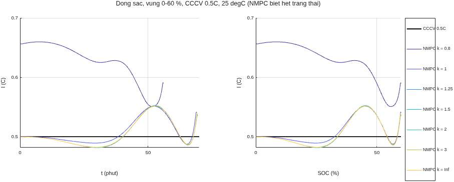
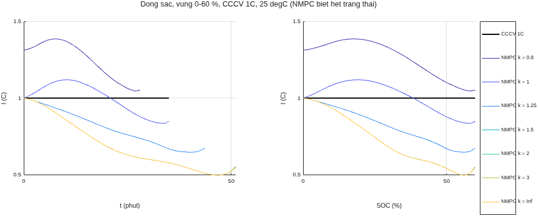
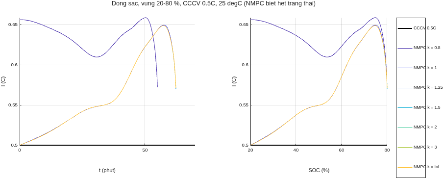
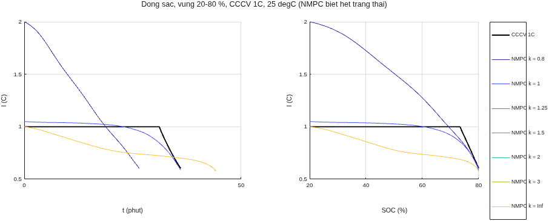
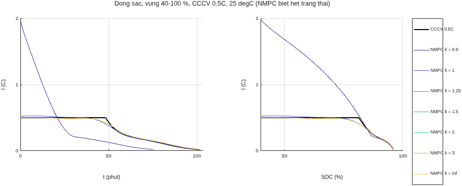
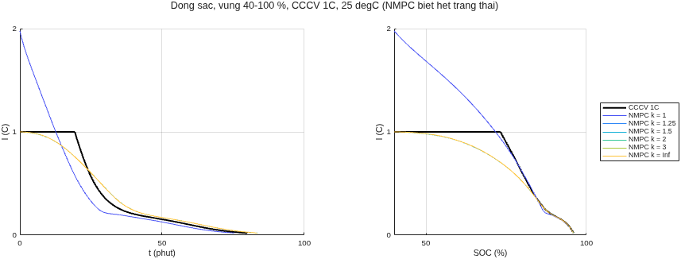

# Kết quả chạy thử NMPC (biết hết trạng thái) so với CCCV, 25 °C

Cập nhật 18/11/2026. 3 vùng (0→60, 20→80, 40→100 %) × CCCV 0.5C / 1C × 7 mức ngân sách k (t ≤ k·T_CCCV) = 42 trường hợp. Số liệu đầy đủ (mọi cột): `tai_lieu/ket_qua_pilot_nmpc.csv`.

**Lưu ý quan trọng:**
- Lão hoá là chấm **hậu kiểm TẠM THỜI** (`aging_source = posthoc_provisional`, GD-81): pin "thật" là DFN không lão hoá, mất vĩnh viễn (SEI + Li chết) tính bằng `aging_rates.m` dọc quỹ đạo DFN, sau sạc **và** xả 0.5C về SOC đầu vùng. Số sẽ đổi khi DFN có lão hoá đã kiểm chứng.
- Nguồn dòng: vùng 0→60 % và 20→80 % từ run 44237965357 (8 bước IRK cố định mỗi khoảng); riêng 20→80 % 1C k = 0.8 từ run 44249331640 (có GD-87; bản cũ có 7 lần giải thất bại). Vùng 40→100 % từ run 44258812043 (có GD-87, GD-88 và sửa `struct2table`); bỏ các dòng 40→100 % của 44237965357 (code cũ, NaN).
- Trạng thái: ok = nạp đủ (tới SOC mà CCCV đạt) trong ngân sách, không vi phạm (ngưỡng 1 mV cho V/η); ok_violation = nạp đủ nhưng vi phạm ràng buộc trên DFN; infeasible = **không thể sạc an toàn trong thời gian này**.
- "giảm" = 1 − mất NMPC / mất CCCV (dương = NMPC tốt hơn).
- **Dung sai GD-96 (19/11/2026):** nạp thiếu so với điện tích CCCV ≤ 0.5 % SOC và vượt V_cv ≤ 2 mV được tính là "đạt trong dung sai" (ok_tol); η_Li < 45 mV vẫn là vi phạm. Phân loại lại bảng này: **không trường hợp nào đổi trạng thái** (nạp thiếu lớn nhất 0.05 % SOC; hai dòng ok_violation vi phạm η 2.47 mV nên giữ nguyên; CCCV cả 6 trường hợp ok). CSV thêm cột `under_pct`, `status_gd96`, `cccv_status_gd96` (tính bằng `src/nmpc/gd96.py`).

## 1. Bảng kết quả

| Vùng | CCCV | k | ngân sách (s) | trạng thái | t sạc (s) | mất CCCV (mAh) | mất NMPC (mAh) | giảm (%) | η_Li min (mV) | vi phạm V / η (mV) | lần giải / thất bại | giải TB (ms) | thời gian job (s) | run |
|---|---|---|---|---|---|---|---|---|---|---|---|---|---|---|
| 0-60 | 0.5C | 0.8 | 3360 | ok | 3357 | 0.01175 | 0.01183 | -0.7 | 82.0 | 0.00 / 0.00 | 178 / 0 | 7849 | 2172 | 44237965357 |
| 0-60 | 0.5C | 1 | 4200 | ok | 4138 | 0.01175 | 0.01170 | 0.4 | 84.9 | 0.00 / 0.00 | 204 / 0 | 6070 | 1918 | 44237965357 |
| 0-60 | 0.5C | 1.25 | 5250 | ok | 4161 | 0.01175 | 0.01170 | 0.4 | 85.2 | 0.00 / 0.00 | 205 / 0 | 8950 | 2655 | 44237965357 |
| 0-60 | 0.5C | 1.5 | 6300 | ok | 4161 | 0.01175 | 0.01170 | 0.5 | 85.3 | 0.00 / 0.00 | 205 / 0 | 11998 | 3267 | 44237965357 |
| 0-60 | 0.5C | 2 | 8400 | ok | 4161 | 0.01175 | 0.01170 | 0.5 | 85.2 | 0.00 / 0.00 | 205 / 0 | 8291 | 2380 | 44237965357 |
| 0-60 | 0.5C | 3 | 12599 | ok | 4161 | 0.01175 | 0.01170 | 0.5 | 85.2 | 0.00 / 0.00 | 205 / 0 | 17622 | 4239 | 44237965357 |
| 0-60 | 0.5C | ∞ | ∞ | ok | 4160 | 0.01175 | 0.01170 | 0.5 | 85.1 | 0.00 / 0.00 | 205 / 0 | 8267 | 2433 | 44237965357 |
| 0-60 | 1C | 0.8 | 1680 | ok | 1680 | 0.01355 | 0.01424 | -5.0 | 64.3 | 0.00 / 0.00 | 123 / 0 | 19555 | 3136 | 44237965357 |
| 0-60 | 1C | 1 | 2100 | ok | 2100 | 0.01355 | 0.01309 | 3.4 | 70.9 | 0.00 / 0.00 | 137 / 0 | 27579 | 4499 | 44237965357 |
| 0-60 | 1C | 1.25 | 2625 | ok | 2624 | 0.01355 | 0.01216 | 10.3 | 78.0 | 0.00 / 0.00 | 154 / 0 | 23592 | 4227 | 44237965357 |
| 0-60 | 1C | 1.5 | 3150 | ok | 3071 | 0.01355 | 0.01184 | 12.7 | 84.1 | 0.00 / 0.00 | 169 / 0 | 15672 | 3259 | 44237965357 |
| 0-60 | 1C | 2 | 4200 | ok | 3072 | 0.01355 | 0.01184 | 12.7 | 84.4 | 0.00 / 0.00 | 169 / 0 | 11977 | 2825 | 44237965357 |
| 0-60 | 1C | 3 | 6300 | ok | 3072 | 0.01355 | 0.01184 | 12.7 | 84.3 | 0.00 / 0.00 | 169 / 0 | 19570 | 3963 | 44237965357 |
| 0-60 | 1C | ∞ | ∞ | ok | 3073 | 0.01355 | 0.01184 | 12.7 | 84.4 | 0.00 / 0.00 | 169 / 0 | 9669 | 2102 | 44237965357 |
| 20-80 | 0.5C | 0.8 | 3360 | ok | 3300 | 0.03641 | 0.03560 | 2.2 | 62.0 | 0.00 / 0.00 | 177 / 0 | 7208 | 1916 | 44237965357 |
| 20-80 | 0.5C | 1 | 4200 | ok | 3741 | 0.03641 | 0.03558 | 2.3 | 62.3 | 0.00 / 0.00 | 191 / 0 | 13646 | 3248 | 44237965357 |
| 20-80 | 0.5C | 1.25 | 5250 | ok | 3741 | 0.03641 | 0.03558 | 2.3 | 62.4 | 0.00 / 0.00 | 191 / 0 | 14092 | 3326 | 44237965357 |
| 20-80 | 0.5C | 1.5 | 6300 | ok | 3741 | 0.03641 | 0.03558 | 2.3 | 62.4 | 0.00 / 0.00 | 191 / 0 | 8415 | 2425 | 44237965357 |
| 20-80 | 0.5C | 2 | 8400 | ok | 3741 | 0.03641 | 0.03558 | 2.3 | 62.4 | 0.00 / 0.00 | 191 / 0 | 13255 | 3177 | 44237965357 |
| 20-80 | 0.5C | 3 | 12599 | ok | 3741 | 0.03641 | 0.03558 | 2.3 | 62.4 | 0.00 / 0.00 | 191 / 0 | 6877 | 1990 | 44237965357 |
| 20-80 | 0.5C | ∞ | ∞ | ok | 3741 | 0.03641 | 0.03558 | 2.3 | 62.4 | 0.00 / 0.00 | 191 / 0 | 6669 | 1941 | 44237965357 |
| 20-80 | 1C | 0.8 | 1730 | ok | 1589 | 0.03736 | 0.04071 | -9.0 | 56.1 | 0.00 / 0.00 | 120 / 0 | 24445 | 3551 | 44249331640 |
| 20-80 | 1C | 1 | 2163 | ok | 2163 | 0.03736 | 0.03716 | 0.5 | 57.2 | 0.00 / 0.00 | 139 / 0 | 10158 | 2043 | 44237965357 |
| 20-80 | 1C | 1.25 | 2704 | ok | 2651 | 0.03736 | 0.03602 | 3.6 | 62.0 | 0.00 / 0.00 | 155 / 0 | 8015 | 1743 | 44237965357 |
| 20-80 | 1C | 1.5 | 3245 | ok | 2651 | 0.03736 | 0.03602 | 3.6 | 62.0 | 0.00 / 0.00 | 155 / 0 | 21802 | 3987 | 44237965357 |
| 20-80 | 1C | 2 | 4326 | ok | 2651 | 0.03736 | 0.03602 | 3.6 | 62.0 | 0.00 / 0.00 | 155 / 0 | 21002 | 3875 | 44237965357 |
| 20-80 | 1C | 3 | 6489 | ok | 2651 | 0.03736 | 0.03602 | 3.6 | 62.0 | 0.00 / 0.00 | 155 / 0 | 11383 | 2519 | 44237965357 |
| 20-80 | 1C | ∞ | ∞ | ok | 2652 | 0.03736 | 0.03602 | 3.6 | 62.0 | 0.00 / 0.00 | 155 / 0 | 22438 | 4248 | 44237965357 |
| 40-100 | 0.5C | 0.8 | 4872 | ok_violation | 4528 | 0.08599 | 0.09502 | -10.5 | 42.5 | 1.19 / 2.47 | 216 / 0 | 26721 | 6736 | 44258812043 |
| 40-100 | 0.5C | 1 | 6090 | ok | 6080 | 0.08599 | 0.08631 | -0.4 | 70.1 | 0.00 / 0.00 | 264 / 0 | 46572 | 12975 | 44258812043 |
| 40-100 | 0.5C | 1.25 | 7613 | ok | 6197 | 0.08599 | 0.08660 | -0.7 | 70.5 | 0.00 / 0.00 | 265 / 0 | 35030 | 9956 | 44258812043 |
| 40-100 | 0.5C | 1.5 | 9135 | ok | 6199 | 0.08599 | 0.08662 | -0.7 | 70.5 | 0.00 / 0.00 | 267 / 0 | 20708 | 6455 | 44258812043 |
| 40-100 | 0.5C | 2 | 12180 | ok | 6198 | 0.08599 | 0.08661 | -0.7 | 70.5 | 0.00 / 0.00 | 267 / 0 | 17681 | 5427 | 44258812043 |
| 40-100 | 0.5C | 3 | 18270 | ok | 6199 | 0.08599 | 0.08662 | -0.7 | 70.5 | 0.00 / 0.00 | 267 / 0 | 16110 | 4833 | 44258812043 |
| 40-100 | 0.5C | ∞ | ∞ | ok | 6200 | 0.08599 | 0.08663 | -0.7 | 70.5 | 0.00 / 0.00 | 268 / 0 | 19096 | 5832 | 44258812043 |
| 40-100 | 1C | 0.8 | 3839 | infeasible | — | 0.08888 | — | — | — | — / — | — / — | — | 567 | 44258812043 |
| 40-100 | 1C | 1 | 4799 | ok_violation | 4525 | 0.08888 | 0.09498 | -6.9 | 42.5 | 1.19 / 2.47 | 212 / 0 | 23164 | 5500 | 44258812043 |
| 40-100 | 1C | 1.25 | 5999 | ok | 5016 | 0.08888 | 0.08794 | 1.1 | 62.4 | 0.14 / 0.00 | 229 / 0 | 25603 | 6710 | 44258812043 |
| 40-100 | 1C | 1.5 | 7199 | ok | 5016 | 0.08888 | 0.08791 | 1.1 | 62.4 | 0.14 / 0.00 | 227 / 0 | 26938 | 6919 | 44258812043 |
| 40-100 | 1C | 2 | 9599 | ok | 5015 | 0.08888 | 0.08793 | 1.1 | 62.4 | 0.14 / 0.00 | 228 / 0 | 22968 | 5905 | 44258812043 |
| 40-100 | 1C | 3 | 14398 | ok | 5016 | 0.08888 | 0.08794 | 1.1 | 62.4 | 0.14 / 0.00 | 229 / 0 | 21374 | 5571 | 44258812043 |
| 40-100 | 1C | ∞ | ∞ | ok | 5015 | 0.08888 | 0.08792 | 1.1 | 62.4 | 0.14 / 0.00 | 227 / 0 | 28626 | 7337 | 44258812043 |

## 2. Nhận xét

- **0→60 % 1C:** lợi rõ nhất, giảm 10–13 % khi k ≥ 1.25; k = 1: 3.4 %; k = 0.8 (nhanh hơn CCCV): mất nhiều hơn 5 %.
- **20→80 %:** 0.5C giảm 2.2–2.3 %; 1C giảm 3.6 % khi k ≥ 1.25, 0.5 % khi k = 1, k = 0.8 mất nhiều hơn 9 %.
- **0→60 % 0.5C:** gần như bằng CCCV (−0.7 … +0.5 %).
- **40→100 % 1C:** k ≥ 1.25 giảm 1.1 %; k = 0.8 không thể sạc an toàn (nhanh nhất trên ROM 4620 s > 3839 s); k = 1 nạp đủ nhưng **vi phạm** (η_Li min 42.5 mV < 45 mV, V vượt 1.2 mV) và mất nhiều hơn CCCV 6.9 %.
- **40→100 % 0.5C:** NMPC **kém CCCV 0.4–0.7 %** ở mọi k ≥ 1; k = 0.8 vi phạm như trên (−10.5 %).
- Với k ≥ 1.25 NMPC hội tụ về cùng thời gian sạc bất kể ngân sách: ngân sách không còn ràng buộc, chỉ tối thiểu lão hoá.
- **Bộ giải (sau GD-87):** 0 lần thất bại ở cả 15 trường hợp 40→100 % chạy lại (trước: 1–11 lần/trường hợp, NaN). Giải trung bình 16–47 s ở 40→100 % (300–395 bước IRK mỗi lần tuyến tính hoá), 6–28 s ở hai vùng kia; job dài nhất 3.6 h (40→100 % 0.5C k = 1).

## 3. Chẩn đoán (ROM chạy lại, run 44258903310)

1. **Vi phạm ở 40→100 %, ngân sách sát (0.5C k = 0.8, 1C k = 1):** không do ROM lệch DFN. Chạy lại cùng profile trên ROM cho η_Li min **giống** DFN (41.2 / 41.2 mV ở bản cũ); lệch η pin − ROM đo trong vòng kín chỉ −0.06 mV (cột `eb_min_mV`). Kiểm tra trên DFN (`nmpc_safe_plant`, GD-88) cho thấy có cách sạc an toàn trong 4500 s < ngân sách, nên ngân sách **khả thi**; vi phạm là do bộ điều khiển. Nguyên nhân có thể (chưa kiểm chứng riêng): ràng buộc chỉ áp ở 20 nút dự báo (cách nhau ~225 s) và là ràng buộc mềm, nên giữa hai nút ở dòng lớn η có thể xuống dưới δ; thêm nghiệm status 2 (chưa hội tụ, ≤ 4 vòng SQP) được chấp nhận.
2. **40→100 % 0.5C kém CCCV 0.4–0.7 %:** ROM cũng xếp hạng như DFN (ROM: CCCV 0.07619, NMPC 0.0778 mAh), lệch V ROM − DFN ở 1/4 cuối chỉ 0.3 mV ⇒ không do ROM. NMPC sạc lâu hơn ~110 s (6197 so với 6090 s): đoạn đầu "CCCV an toàn" trên ROM dùng bậc dòng không đổi 30 s (6180 s), chậm hơn pha CV liên tục của CCCV; SQP (≤ 4 vòng mỗi lần giải nóng) không rời xa đoạn đầu. Ở vùng kết thúc gần đầy, pha CV chiếm phần lớn nên lợi tối đa có thể rất nhỏ.

## 4. Giới hạn và hướng cải thiện (chưa làm)

- Lão hoá hậu kiểm tạm thời (xem trên).
- Vi phạm η/V ở ngân sách sát của 40→100 %: có thể thêm ràng buộc giữa các nút hoặc tăng N; chưa làm.
- Khoảng 0.4–0.7 % kém CCCV ở 40→100 % 0.5C: hướng cải thiện là đoạn đầu CCCV với pha CV liên tục trên ROM. **Người dùng quyết định không làm lúc này** (18/11/2026); báo cáo đúng như số liệu.
- Chỉ 25 °C, 3 vùng, NMPC biết hết trạng thái. Kết quả NMPC + EKF: `ket_qua_nmpc_ekf.md`.

## 5. Phân tích dòng điện (19/11/2026)

Tính trên CI bằng `src/nmpc/current_analysis.m` (stage `current` của `nmpc.yml`, run 44421878394) từ CSV quỹ đạo của chính các job ở bảng mục 1 (cùng nguồn: 44237965357 cho 0→60 / 20→80 %, 44249331640 cho 20→80 % 1C k = 0.8, 44258812043 cho 40→100 %). Không đọc số từ hình. Kết quả đầy đủ: `tai_lieu/dong_sac/current_metrics.csv` (mỗi cách sạc × trường hợp) và `tai_lieu/dong_sac/current_soc_bins.csv` (dòng trung bình mỗi khoảng SOC 10 %, dùng cho bảng sạc nhiều bậc ở bước H). Cột `method = NMPC+EKF` thuộc `ket_qua_nmpc_ekf.md`.

**Định nghĩa** (1C = 5 A, I_max = 2C = 10 A, SOC = SOC pin thật):
- I TB = điện tích nạp / thời gian sạc. Dòng TB mỗi khoảng SOC = ∫I dt / thời gian trong khoảng đó.
- SOC bắt đầu giảm dòng = SOC ở mẫu đầu tiên sau đỉnh mà I < 0.95 I_đỉnh. Với CCCV so với SOC lúc chuyển CC → CV (V chạm V_cv − 1 mV).
- Phần điện tích nạp ở SOC > 80 %; thời gian ở I_max (I ≥ 0.99 I_max); η_Li min khi dòng lớn (I ≥ 0.8 I_đỉnh); thời gian η_Li < 50 mV (cách giới hạn 45 mV dưới 5 mV).

Hình: dòng theo thời gian (trái) và theo SOC (phải); đen = CCCV, màu = NMPC từng k.

### 5.1. Dòng trung bình (C) mỗi khoảng SOC 10 % (NMPC biết hết trạng thái)

k = 1.5, 2, 3 trùng k = ∞ (sai khác ≤ 0.01C) nên không in; đủ mọi k trong CSV.

| Vùng | CCCV | cách sạc | 0–10 % | 10–20 % | 20–30 % | 30–40 % | 40–50 % | 50–60 % | 60–70 % | 70–80 % | 80–90 % | 90–100 % |
|---|---|---|---|---|---|---|---|---|---|---|---|---|
| 0-60 | 0.5C | CCCV | 0.50 | 0.50 | 0.50 | 0.50 | 0.50 | 0.50 |  |  |  |  |
| 0-60 | 0.5C | NMPC k = 0.8 | 0.66 | 0.66 | 0.64 | 0.63 | 0.62 | 0.56 |  |  |  |  |
| 0-60 | 0.5C | NMPC k = 1 | 0.50 | 0.49 | 0.49 | 0.51 | 0.55 | 0.51 |  |  |  |  |
| 0-60 | 0.5C | NMPC k = 1.25 | 0.50 | 0.49 | 0.48 | 0.51 | 0.55 | 0.51 |  |  |  |  |
| 0-60 | 0.5C | NMPC k = ∞ | 0.50 | 0.49 | 0.48 | 0.51 | 0.55 | 0.51 |  |  |  |  |
| 0-60 | 1C | CCCV | 1.00 | 1.00 | 1.00 | 1.00 | 1.00 | 1.00 |  |  |  |  |
| 0-60 | 1C | NMPC k = 0.8 | 1.33 | 1.38 | 1.36 | 1.27 | 1.16 | 1.06 |  |  |  |  |
| 0-60 | 1C | NMPC k = 1 | 1.04 | 1.11 | 1.10 | 1.03 | 0.93 | 0.85 |  |  |  |  |
| 0-60 | 1C | NMPC k = 1.25 | 0.98 | 0.92 | 0.85 | 0.78 | 0.71 | 0.66 |  |  |  |  |
| 0-60 | 1C | NMPC k = ∞ | 0.97 | 0.87 | 0.74 | 0.63 | 0.58 | 0.51 |  |  |  |  |
| 20-80 | 0.5C | CCCV |  |  | 0.50 | 0.50 | 0.50 | 0.50 | 0.50 | 0.50 |  |  |
| 20-80 | 0.5C | NMPC k = 0.8 |  |  | 0.65 | 0.64 | 0.63 | 0.61 | 0.64 | 0.65 |  |  |
| 20-80 | 0.5C | NMPC k = 1 |  |  | 0.51 | 0.53 | 0.54 | 0.56 | 0.61 | 0.64 |  |  |
| 20-80 | 0.5C | NMPC k = 1.25 |  |  | 0.51 | 0.53 | 0.55 | 0.56 | 0.61 | 0.64 |  |  |
| 20-80 | 0.5C | NMPC k = ∞ |  |  | 0.51 | 0.53 | 0.55 | 0.56 | 0.61 | 0.64 |  |  |
| 20-80 | 1C | CCCV |  |  | 1.00 | 1.00 | 1.00 | 1.00 | 1.00 | 0.85 |  |  |
| 20-80 | 1C | NMPC k = 0.8 |  |  | 1.96 | 1.82 | 1.61 | 1.39 | 1.12 | 0.80 |  |  |
| 20-80 | 1C | NMPC k = 1 |  |  | 1.04 | 1.04 | 1.03 | 1.02 | 0.97 | 0.78 |  |  |
| 20-80 | 1C | NMPC k = 1.25 |  |  | 0.97 | 0.90 | 0.82 | 0.75 | 0.72 | 0.67 |  |  |
| 20-80 | 1C | NMPC k = ∞ |  |  | 0.97 | 0.90 | 0.82 | 0.75 | 0.72 | 0.67 |  |  |
| 40-100 | 0.5C | CCCV |  |  |  |  | 0.50 | 0.50 | 0.50 | 0.50 | 0.31 | 0.10 |
| 40-100 | 0.5C | NMPC k = 0.8 |  |  |  |  | 1.82 | 1.54 | 1.23 | 0.83 | 0.30 | 0.09 |
| 40-100 | 0.5C | NMPC k = 1 |  |  |  |  | 0.53 | 0.52 | 0.51 | 0.48 | 0.30 | 0.10 |
| 40-100 | 0.5C | NMPC k = 1.25 |  |  |  |  | 0.50 | 0.50 | 0.49 | 0.47 | 0.29 | 0.10 |
| 40-100 | 0.5C | NMPC k = ∞ |  |  |  |  | 0.50 | 0.50 | 0.49 | 0.47 | 0.29 | 0.10 |
| 40-100 | 1C | CCCV |  |  |  |  | 1.00 | 1.00 | 1.00 | 0.85 | 0.31 | 0.09 |
| 40-100 | 1C | NMPC k = 1 |  |  |  |  | 1.82 | 1.54 | 1.23 | 0.83 | 0.30 | 0.09 |
| 40-100 | 1C | NMPC k = 1.25 |  |  |  |  | 0.99 | 0.95 | 0.85 | 0.65 | 0.31 | 0.10 |
| 40-100 | 1C | NMPC k = ∞ |  |  |  |  | 0.99 | 0.95 | 0.85 | 0.65 | 0.31 | 0.10 |

### 5.2. Chỉ số chính

| Vùng | CCCV | cách sạc | t sạc (s) | I đỉnh (C) | I TB (C) | SOC bắt đầu giảm dòng | SOC khi V chạm V_cv | t ở I_max (s) | η_Li min khi dòng lớn (mV) | t η_Li < 50 mV (s) |
|---|---|---|---|---|---|---|---|---|---|---|
| 0-60 | 0.5C | CCCV | 4200 | 0.50 | 0.50 | — | — | 0 | 87.2 | 0 |
| 0-60 | 0.5C | NMPC k = 0.8 | 3357 | 0.66 | 0.63 | 0.322 | — | 0 | 82.0 | 0 |
| 0-60 | 0.5C | NMPC k = 1 | 4138 | 0.55 | 0.51 | 0.517 | — | 0 | 84.9 | 0 |
| 0-60 | 0.5C | NMPC k = 1.25 | 4161 | 0.55 | 0.50 | 0.517 | — | 0 | 85.2 | 0 |
| 0-60 | 0.5C | NMPC k = ∞ | 4160 | 0.55 | 0.50 | 0.516 | — | 0 | 85.1 | 0 |
| 0-60 | 1C | CCCV | 2100 | 1.00 | 1.00 | — | — | 0 | 64.6 | 0 |
| 0-60 | 1C | NMPC k = 0.8 | 1680 | 1.39 | 1.25 | 0.312 | — | 0 | 71.5 | 0 |
| 0-60 | 1C | NMPC k = 1 | 2100 | 1.12 | 1.00 | 0.314 | — | 0 | 80.5 | 0 |
| 0-60 | 1C | NMPC k = 1.25 | 2624 | 1.00 | 0.80 | 0.102 | — | 0 | 110.6 | 0 |
| 0-60 | 1C | NMPC k = ∞ | 3073 | 1.00 | 0.68 | 0.085 | — | 0 | 150.1 | 0 |
| 20-80 | 0.5C | CCCV | 4200 | 0.50 | 0.50 | — | — | 0 | 67.9 | 0 |
| 20-80 | 0.5C | NMPC k = 0.8 | 3300 | 0.66 | 0.64 | 0.787 | — | 0 | 62.0 | 0 |
| 20-80 | 0.5C | NMPC k = 1 | 3741 | 0.65 | 0.56 | 0.788 | — | 0 | 62.3 | 0 |
| 20-80 | 0.5C | NMPC k = 1.25 | 3741 | 0.65 | 0.56 | 0.788 | — | 0 | 62.4 | 0 |
| 20-80 | 0.5C | NMPC k = ∞ | 3741 | 0.65 | 0.56 | 0.788 | — | 0 | 62.4 | 0 |
| 20-80 | 1C | CCCV | 2163 | 1.00 | 0.97 | 0.742 | 0.734 | 0 | 51.1 | 0 |
| 20-80 | 1C | NMPC k = 0.8 | 1589 | 2.00 | 1.32 | 0.306 | — | 55 | 56.2 | 0 |
| 20-80 | 1C | NMPC k = 1 | 2163 | 1.05 | 0.97 | 0.611 | — | 0 | 57.2 | 0 |
| 20-80 | 1C | NMPC k = 1.25 | 2651 | 1.00 | 0.79 | 0.289 | — | 0 | 87.8 | 0 |
| 20-80 | 1C | NMPC k = ∞ | 2652 | 1.00 | 0.79 | 0.289 | — | 0 | 87.8 | 0 |
| 40-100 | 0.5C | CCCV | 6090 | 0.50 | 0.32 | 0.820 | 0.814 | 0 | 67.6 | 0 |
| 40-100 | 0.5C | NMPC k = 0.8 | 4528 | 1.98 | 0.43 | 0.430 | 0.798 | 0 | 42.5 | 380 |
| 40-100 | 0.5C | NMPC k = 1 | 6080 | 0.53 | 0.32 | 0.719 | 0.855 | 0 | 70.1 | 0 |
| 40-100 | 0.5C | NMPC k = 1.25 | 6197 | 0.50 | 0.32 | 0.756 | 0.856 | 0 | 70.5 | 0 |
| 40-100 | 0.5C | NMPC k = ∞ | 6200 | 0.50 | 0.32 | 0.756 | 0.856 | 0 | 70.5 | 0 |
| 40-100 | 1C | CCCV | 4799 | 1.00 | 0.41 | 0.740 | 0.731 | 0 | 50.7 | 0 |
| 40-100 | 1C | NMPC k = 1 | 4525 | 1.98 | 0.43 | 0.430 | 0.798 | 0 | 42.5 | 380 |
| 40-100 | 1C | NMPC k = 1.25 | 5016 | 1.00 | 0.39 | 0.560 | 0.838 | 0 | 63.5 | 0 |
| 40-100 | 1C | NMPC k = ∞ | 5015 | 1.00 | 0.39 | 0.560 | 0.838 | 0 | 63.5 | 0 |

Phần điện tích nạp ở SOC > 80 % (chỉ vùng 40→100 %) là 0.285–0.287 ở **mọi** cách sạc: cùng một lượng điện tích phải nạp, nên chỉ số này không phân biệt các cách sạc; khác nhau là **thời gian** nạp phần đó (pha giới hạn điện áp).

### 5.3. Dòng tối ưu "trông như thế nào" (nói đơn giản)

- **0→60 %, mức 1C:** bắt đầu bằng đúng 1C rồi **giảm dần đều** theo SOC (k ≥ 1.5: 0.97 → 0.51C, bắt đầu giảm ngay từ SOC ~8 %), không có pha CC phẳng như CCCV. Sạc lâu hơn CCCV 46 % (3072 so với 2100 s) nhưng mất ít hơn 12.7 %. k = 1 (không được lâu hơn CCCV): cùng dòng TB 1.00C nhưng **dồn dòng về đầu** (1.04–1.11C ở 0–30 %, 0.85C ở 50–60 %). k = 0.8: 1.3–1.4C ở nửa đầu rồi giảm.
- **0→60 %, mức 0.5C:** gần như **phẳng như CCCV** (0.48–0.55C), nhô nhẹ 0.55C ở 40–50 %; vì vậy lợi gần như bằng 0.
- **20→80 %, mức 1C:** k ≥ 1.25 bắt đầu 1C rồi giảm dần (0.97 → 0.67C), không dùng pha CV. k = 1: phẳng ~1.03C rồi giảm ở 70–80 % (0.78C), giống CCCV.
- **20→80 %, mức 0.5C:** ngược lại — dòng **tăng dần** theo SOC (0.51 → 0.64C), đỉnh ở SOC ~75 %. Sạc nhanh hơn CCCV (3741 so với 4200 s) mà vẫn lợi 2.3 %: ở mức dòng thấp, SEI theo thời gian trội hơn, nên rút ngắn thời gian ở SOC cao có lợi.
- **40→100 %:** phần trên ~80 % bị giới hạn điện áp ở mọi cách sạc (≈ 0.30C ở 80–90 %, ≈ 0.10C ở 90–100 %). 1C, k ≥ 1.25: giảm dòng **sớm hơn** CCCV (bắt đầu ở SOC 0.56 so với 0.74), 0.99 → 0.65C trong 40–80 % ⇒ chậm hơn 216 s, lợi 1.1 %. 0.5C: gần như trùng CCCV (0.47–0.50C), chỉ giảm dòng mềm hơn trước CV ⇒ chậm hơn ~110 s và **kém** 0.7 % (mục 3).
- **Theo k:** khi ngân sách đủ rộng (k ≥ 1.25 ở 1C, k ≥ 1 ở 0.5C), dòng **không đổi theo k** — ngân sách không còn ràng buộc. Ngân sách sát (k = 0.8, hoặc k = 1 ở 40→100 % 1C) đẩy dòng lên cao ở đầu: đỉnh 1.98–2.00C (gần I_max; chỉ 20→80 % 1C k = 0.8 thực sự ở I_max, 55 s).
- **Gần giới hạn mạ lithium:** η_Li của NMPC khi dòng lớn luôn ≥ 56 mV (CCCV 1C: 50.7–51.1 mV), trừ trường hợp ngân sách sát 40→100 % (0.5C k = 0.8 và 1C k = 1, cùng một profile): 380 s có η_Li < 50 mV khi dòng TB 1.67C, min 42.5 mV — chính là vi phạm ở mục 1. Ở mọi trường hợp khác η_Li không xuống dưới 50 mV, tức ràng buộc mạ lithium **không** là thứ quyết định hình dạng dòng ở 25 °C; hình dạng do cân bằng SEI (dòng lớn) với thời gian sạc.
- **Gợi ý cho bảng nhiều bậc (bước H):** mức 1C: các bậc giảm dần theo SOC (0→60 %, k ≥ 1.5: 0.97 / 0.87 / 0.74 / 0.63 / 0.58 / 0.51C cho từng khoảng 10 %; 20→80 %, k ≥ 1.25: 0.97 → 0.67C); mức 0.5C: giữ gần CCCV, ở 20→80 % có thể tăng nhẹ về cuối. Giá trị cụ thể lấy từ `current_soc_bins.csv`.
